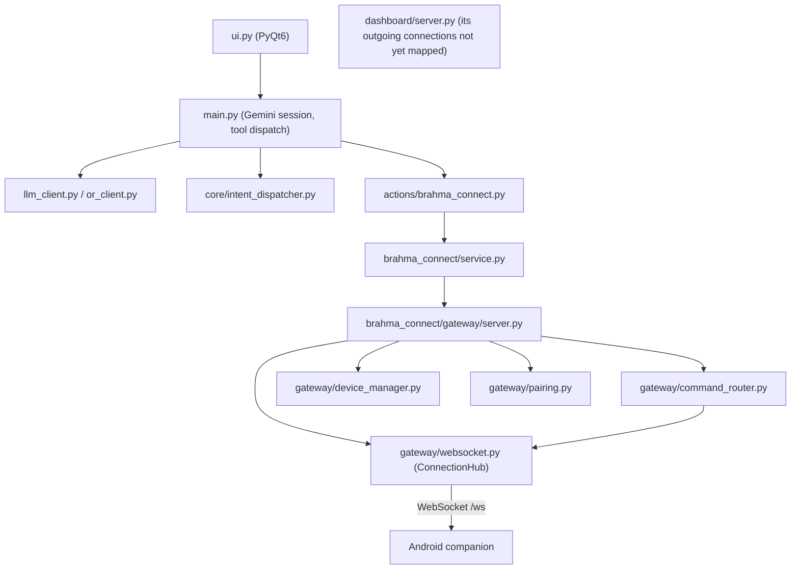
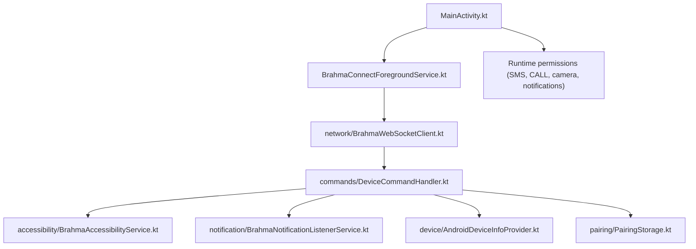

# Dependency Map

Only the connections confirmed in the code read during this audit are listed. Arrows show the direction of a call or import.

## PC side

Not confirmed in this audit: which `features/*` modules `core/intent_dispatcher.py` calls. The dispatcher does not import from `features/` directly.

## Android side

## Interfaces that must match across the boundary

| Interface | PC side | Android side | Status |
|---|---|---|---|
| WebSocket message envelope | `gateway/protocol.py` | `core/AppModels.kt` (`BrahmaProtocol`) | Both sides define the same message type names, but no shared schema file exists |
| Command execute | `gateway/command_router.py` sends `execute` | `DeviceCommandHandler.handle(action, parameters)` | Matching names confirmed for existing commands |
| Pairing | `gateway/pairing.py`, `GET /gateway/pair` | `pairing/PairingPayloadParser.kt` | Exchange confirmed; security gap, see audit |
| Result | `command_router` expects result dict | `CommandResult.toJson()` | Confirmed |

## Missing edges (planned, not present)

- Phone-side voice → `DeviceCommandHandler` (no voice module on the phone).
- Verification → Master Brain (no verification module).
- Shared memory → both devices (no shared memory module).
